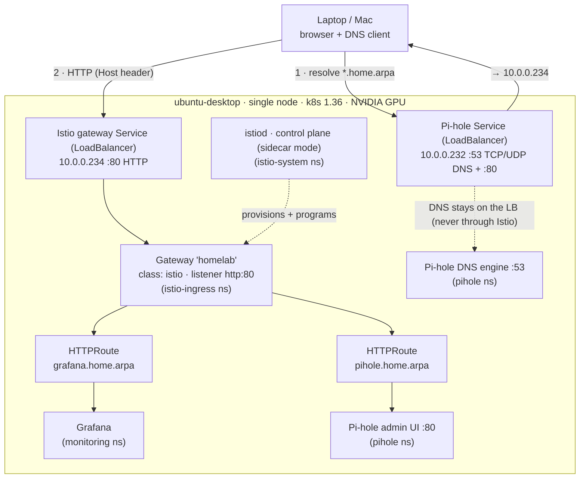
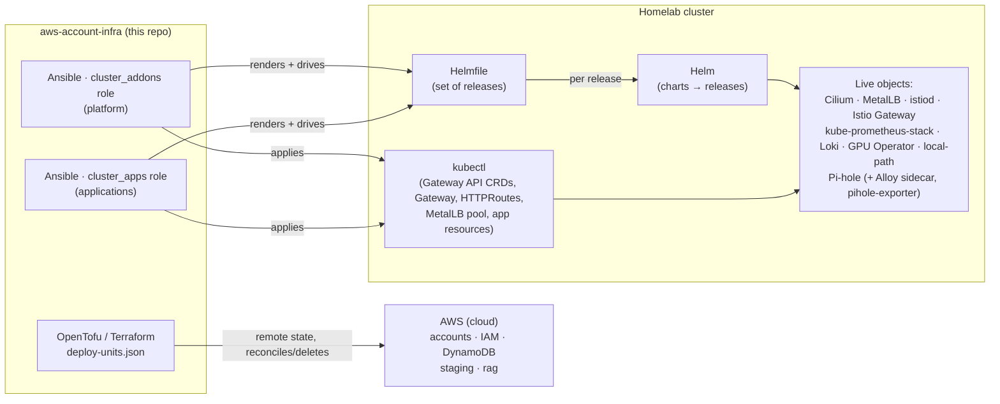
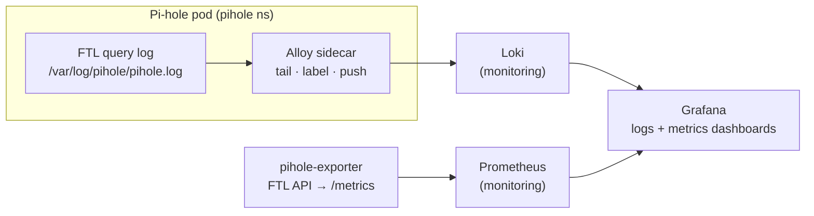

# Homelab platform architecture

A visual overview of the Kubernetes homelab platform managed from this repo:
observability, DNS, and Istio Gateway API ingress on a single GPU node.

## Runtime / traffic + DNS flow

How a request from the laptop reaches Grafana or the Pi-hole admin UI, and how
DNS is served.



## How it is managed (IaC layering)

The tooling boundary: OpenTofu owns AWS (cloud), Ansible owns everything inside
the homelab cluster via Helmfile/Helm and kubectl.



## Addresses & endpoints

| Address / name | What |
|---|---|
| `10.0.0.156` | Node `ubuntu-desktop`, Kubernetes API `:6443` |
| `10.0.0.232` | Pi-hole `LoadBalancer` — **DNS** (`:53` TCP/UDP) + web `:80` |
| `10.0.0.234` | Istio gateway `LoadBalancer` — **ingress** (`:80` HTTP) |
| `grafana.home.arpa` | → `10.0.0.234` → Grafana (monitoring) |
| `pihole.home.arpa` | → `10.0.0.234` → Pi-hole admin UI (pihole) |
| MetalLB pool | `10.0.0.231–10.0.0.253` |

## Components

Platform via the `cluster_addons` role; applications via the `cluster_apps` role.

| Component | Role | Namespace | Managed by |
|---|---|---|---|
| Cilium | CNI (kube-proxy mode, VXLAN tunnel) | `kube-system` | cluster_addons |
| MetalLB | LoadBalancer IP assignment | `metallb-system` | cluster_addons |
| local-path-provisioner | Default storage class | `local-path-storage` | cluster_addons |
| metrics-server | Resource metrics | `kube-system` | cluster_addons |
| GPU Operator | NVIDIA GPU enablement | `gpu-operator` | cluster_addons |
| istiod + Istio Gateway | Gateway API ingress (sidecar mode) | `istio-system`, `istio-ingress` | cluster_addons |
| kube-prometheus-stack | Prometheus, Alertmanager, Grafana | `monitoring` | cluster_addons |
| Loki (single-binary) | Log storage (filesystem, local-path) | `monitoring` | cluster_addons |
| Pi-hole (Helm chart) | DNS + admin UI | `pihole` | cluster_apps |
| Alloy (sidecar) | Ships Pi-hole query logs to Loki | `pihole` | cluster_apps |
| pihole-exporter | Pi-hole metrics for Prometheus | `pihole` | cluster_apps |

## Observability data flow

DNS query logs and Pi-hole metrics converge in the existing Grafana:



## Notes

- **DNS is L4 and never routed through Istio** — Pi-hole keeps its own
  LoadBalancer on `.232:53`. Only the web admin UI is exposed via the gateway.
- **HTTP only today.** Grafana and Pi-hole admin credentials travel plaintext;
  HTTPS (TLS listener + cert automation) is the first planned follow-up.
- **No workload sidecar injection yet** — istiod is sidecar-capable but the
  east-west mesh (e.g. for a future RAG pipeline) is separate work.
- See `docs/gateway-api.md` and `docs/observability.md` for operational detail,
  and `docs/superpowers/specs/2026-07-06-istio-grafana-ingress-design.md` for the
  design record.
```

