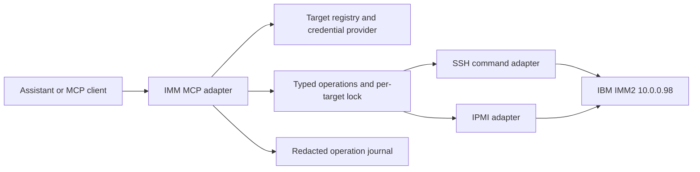

# IBM System x3550 M4 IMM2 management reference and MCP design

Status: formal capability reference and proposed design, not an implemented MCP server.
Observed: 2026-09-17. Target alias proposed for automation: `ibm-host`.

## 1. Target and evidence

| Property | Observed value |
|---|---|
| Management address | `10.0.0.98` |
| Machine type/model | `7914AC1` |
| Controller | IMM2 |
| Firmware | `8.41`, build `1AOOA2C`, release `2021/03/03` |
| Host power | On, independently returned through SSH and IPMI |
| IMM system-state text | `Booting OS or in unsupported OS` |
| Active hardware events | None returned at collection time |
| CLI inventory | 69 advertised entries; includes `?`, `help`, `history`, and `exit` |
| Discovery scope | Queries and help only; no power, configuration, firmware, account or log-clearing commands |

IBM identifies machine type 7914 as System x3550 M4. [IBM model reference](https://www.ibm.com/support/pages/installation-and-service-guide-lenovo-system-x3550-m4-7914)

The IMM's OS-state text is ambiguous; it is not proof that Proxmox is booting, hung, or healthy. Check the host separately. Sensor values and absence of active events are snapshots, not ongoing monitoring guarantees.

Evidence files:

- [Live responses](imm2-live-capabilities.json): read-only queries, help, IPMI result and protocol observations. No credentials are stored.
- [CLI help appendix](imm2-cli-help.md): actual argument help for all 65 non-utility entries, plus embedded ASU help.
- [Official-interface research](imm2-official-interfaces.md): IBM/Lenovo citations, licensing and cross-platform limitations.

The SSH key fingerprint in the evidence was observed at first contact, not independently authenticated. Subsequent discovery connections checked that fingerprint. Initial HTTPS discovery bypassed certificate verification; that is not the proposed MCP trust configuration.

## 2. Protocols: what works on this box

| Interface | Endpoint | Live evidence | Proposed use |
|---|---|---|---|
| SSH CLI | TCP 22 | Authenticated shell, help and queries succeeded | Main adapter for IMM-specific data/configuration |
| IPMI LAN | UDP 623 | Authenticated `get_power` returned `on`; CLI reports IPMI enabled | Standard power and hardware operations; only power read verified so far |
| Web UI | HTTPS 443, HTTP 80 | Login page served | Human management; no stable private web API contract established |
| Redfish | HTTPS `/redfish/v1/` | HTTP 404 | Do not implement a Redfish adapter for this target without further proof |
| WS-Management | TCP 5985/5986, `/wsman` | Unauthenticated Identify received HTTP 401 Basic; authenticated HTTPS Identify disconnected | Reachable listener, but no successful SOAP operation established |
| SNMP | Normally UDP 161/162 | Not tested or configured in this research | Possible sensor polling/traps after separate validation |
| CIM/XML | Normally TCP 5988/5989 | Not probed | Possible legacy integration; classes/methods not inventoried |
| Serial-over-LAN | IPMI/host serial configuration | Documented, not tested | Separate interactive-session capability |
| Graphical KVM/virtual media | Remote-presence client | Entitlement and operation not checked | Separate integration; not ordinary text tools |

A closed **TCP** 623 port does not test IPMI, which was verified over **UDP**. Some newer IMM2 firmware families support Redfish; this older 1AOO unit has no established Redfish contract. Documented ports and feature distinctions are in the [official research](imm2-official-interfaces.md#interfaces-and-scope).

## 3. Complete advertised CLI inventory

This table covers every entry returned by this unit's `help`, grouped by purpose. Listing is not execution proof. Exact options are in the [live appendix](imm2-cli-help.md). “Mixed” means arguments can choose a read or a mutation; a future MCP must expose those as distinct operations.

| Family | All advertised entries | Scope and operation type |
|---|---|---|
| CLI session | `?`, `help`, `history`, `exit`, `set` | Discovery, session/history and CLI environment; `set` is mixed |
| Identity/inventory | `vpd`, `adapter`, `storage` | Identity, firmware, adapters and storage; availability varies |
| Health/sensors | `syshealth`, `temps`, `fans`, `volts`, `led` | Health, active events, thresholds and indicators; read |
| Event log | `readlog`, `clearlog`, `events` | Read/export logs, delete logs, configure event handling; mixed |
| Host power/boot | `power`, `reset`, `pxeboot`, `fuelg`, `thermal`, `timeouts` | Power state/actions, boot selection, power/thermal policies and watchdog timing; mixed |
| Serial console | `console`, `srcfg`, `portcfg` | Interactive console and serial settings; mixed |
| Network/services | `ifconfig`, `dns`, `dhcpinfo`, `ports`, `portcontrol`, `usbeth`, `ethtousb` | Network addressing, DNS, service ports, IPMI enablement and USB networking; mixed |
| Time | `clock`, `ntp` | Clock, timezone and time synchronization; mixed |
| Notifications | `alertcfg`, `alertentries`, `smtp`, `snmp`, `snmpalerts`, `sdemail` | Alert destinations, mail, SNMP configuration and service-mail transmission; mixed |
| Accounts/security | `accseccfg`, `users`, `gprofile`, `passwordcfg`, `ldap`, `sshcfg`, `telnetcfg`, `cryptomode`, `ssl`, `sslcfg`, `tls` | Accounts, roles, authentication, transport security and certificates; mixed |
| Host/controller settings | `asu`, `info` | Embedded UEFI settings utility and IMM descriptive settings; mixed |
| Controller lifecycle | `resetsp`, `spreset`, `identify`, `clearcfg`, `restoredefaults` | Restart IMM, locator indicator and factory/default reset; writes |
| Configuration files | `backup`, `restore`, `autopromo`, `autoftp`, `batch` | Export/import, automatic transfers/promotion and command-file execution; writes or mixed |
| Service diagnostics | `ffdc`, `chconfig`, `chlog`, `chmanual` | Diagnostic file lifecycle and Service Advisor configuration/logs/call-home; mixed |
| Entitlements | `keycfg` | Feature activation-key management; mixed, sensitive |
| Multinode | `scale` | Multinode configuration/control; platform-dependent, untested |

The official catalog also contains commands absent from this unit's help, such as `sdraid` and `storekeycfg`. Do not expose those merely because another IMM2 guide lists them. The reverse also matters: the live `power -h` supplies `power uefi` and `power -rp`, so do not blindly substitute a cross-platform guide's syntax.

### Queries verified on this unit

| Query | Result/limitation |
|---|---|
| `vpd imm`, `vpd fw` | Controller and system firmware information returned |
| `vpd sys` | Machine identity returned in the preceding discovery session; serial/UUID omitted from this reference |
| `syshealth summary`, `syshealth activeevents` | Returned power/system state and no active event at collection time |
| `power state` | On; agrees with IPMI |
| `temps`, `fans`, `volts`, `led` | Sensor/indicator data returned |
| `storage -list controllers` | `ctrl[3]`, ServeRAID M5110 in PCI Slot 3 |
| `storage -list devices` | Eight reported drives (0–7) showed Normal; not proof that every host-visible disk is managed by IMM |
| `adapter -list` | Explicitly unsupported on this platform, despite advertised help |
| `pxeboot` | Next-boot PXE setting disabled |
| `fuelg` | Power-management configuration returned; power capping disabled |
| `portcontrol` | IPMI service enabled |
| `asu --help` | Embedded UEFI utility syntax returned; no setting changes or general value dump attempted |

`fuelg` configuration values are not a measurement of instantaneous wattage. Do not report its configured cap as actual power consumption. The temperature `T` column is the current value; the other columns are thresholds/hysteresis. Values include Fahrenheit/Celsius, and `N/A` is not zero. [Temperature output reference](https://pubs.lenovo.com/imm2/dw1lm_r_tempscommand)

### Power and boot operations

These operations are available in this firmware's help; **no mutating operation below was tested**.

| Desired operation | CLI form | Interpretation |
|---|---|---|
| Read state | `power state` | Verified read |
| Turn on | `power on` | Start physical host |
| Graceful shutdown request | `power off -s` | Request OS shutdown before power-off |
| Forced off | `power off` | No OS-shutdown option |
| Graceful power-cycle request | `power cycle -s` | Request shutdown, then off/on |
| Forced power cycle | `power cycle` | Off/on without graceful option |
| Graceful reset request | `reset -s` | Request OS shutdown before reset |
| Forced reset | `reset` | Reset without graceful option |
| Diagnostic interrupt | `reset -nmi` | NMI; not a normal restart |
| Boot UEFI setup | `power uefi` | Advertised; transition prerequisites not tested |
| Set next PXE boot | `pxeboot -en enabled` / `disabled` | Boot-setting mutation |
| AC power-return policy | `power -rp alwayson` / `alwaysoff` / `restore` | Live-help syntax |
| Restart IMM | `resetsp` / `spreset` | Management-controller restart; distinct from host reset |

Scheduled power actions and delayed reset are also advertised; exact options are in the appendix. Graceful completion depends on OS cooperation. Follow up with state checks; never convert a timeout into a forced shutdown automatically. Mains power and an independent network path must remain available to turn the host back on. These distinctions are supported by [Lenovo's power](https://pubs.lenovo.com/imm2/aj1camst04) and [reset](https://pubs.lenovo.com/imm2/aj1camst05) references.

### Other administrative capabilities and limits

- **UEFI:** ASU advertises `show`, `showvalues`, `showgroups`, `help`, `set`, `delete`, and transactions (`tropen`, `trset`, `trlist`, `trcommit`, `trrm`). Validate each named setting and allowed value for this platform; do not expose `set all` or arbitrary batch text. Reboot requirements are documented in the [ASU reference](https://pubs.lenovo.com/imm2/nn1ia_r_asucommand).
- **Configuration backup:** IMM settings export/restore is separate from Proxmox, VM, disk and PostgreSQL backups. Exported settings can contain credentials. Destinations and passphrases belong in private runtime configuration. See [backup semantics](https://pubs.lenovo.com/imm2/dw1lm_r_backupcommand).
- **Diagnostics:** FFDC advertises generate/status/copy/delete. Generation and transfer have side effects; separate them from reading status. `readlog` pagination changes its session cursor, not the underlying event log.
- **Storage:** this firmware's help advertises inventory/detail reads. It does not establish RAID creation, disk wipe or array-reconfiguration support. Keep that separate from a host storage-management tool.
- **Firmware updates:** a version query is supported; a verified update automation path is not established. No general update verb appears in the live CLI inventory. Use a documented, platform-matched vendor tool/workflow before proposing an MCP updater.
- **KVM/virtual media:** entitlement and client compatibility are unverified. They require a session-oriented design, not a promise that an ordinary MCP text tool can provide a graphical console. See [official licensing and remote-presence research](imm2-official-interfaces.md#uefi-firmware-console-and-licensing-boundaries).
- **Internal web requests:** UI endpoints may exist but have not been authenticated, catalogued or established as stable public APIs. No invented REST paths are part of this reference.

## 4. Proposed MCP architecture

This section specifies a future implementation. None of these tools are installed or registered.



Use SSH for target-specific information and typed IMM commands. Use IPMI for standardized operations as each is validated; only its power read is currently confirmed. Do not switch transports automatically after an ambiguous write failure, because that can repeat the action.

The server is the preferred routine runtime, consistent with the existing homelab policy. However, a process running on this IBM host cannot power that same host back on. Provide an independent recovery instance on the Mac or another always-on management device, with separately available credentials, DNS/addressing and audit storage. If both instances can write, serialize operations through one authoritative management service or explicitly allow only one write-enabled instance at a time. A process-local lock does not coordinate two instances.

A local integration can use stdio. A shared service can use authenticated Streamable HTTP on the private management network. Select and pin an official SDK/protocol version compatible with the actual client during implementation. [Official MCP transport guidance](https://github.com/modelcontextprotocol/typescript-sdk/blob/main/docs/server.md)

### Phase 1: typed read tools

Every tool takes a registered `target` alias, not an arbitrary host or credentials. Responses identify collection time, transport, parser version, evidence level and unsupported fields.

| Proposed tool | Additional input | Transport/command mapping |
|---|---|---|
| `imm_get_capabilities` | Optional refresh | Cached probe results, firmware, live help; no write probes |
| `imm_get_identity` | Detail enum | `vpd sys`, `vpd imm`, `vpd fw` |
| `imm_get_health` | None | `syshealth summary`, `syshealth activeevents` |
| `imm_get_power_state` | None | Verified IPMI query or `power state` |
| `imm_get_sensors` | Sensor-kind enum | `temps`, `fans`, `volts`; preserve units/thresholds |
| `imm_get_indicators` | None | `led` |
| `imm_get_events` | Bounded page size, cursor, supported filters | `readlog`; isolated session/cursor, no `clearlog` |
| `imm_get_storage` | List-kind enum, validated target ID | `storage -list ...`, supported `-show` forms |
| `imm_get_boot_settings` | None | `pxeboot`; other boot queries only after verification |
| `imm_get_power_policy` | None | `fuelg`; label as policy, not measured wattage |
| `imm_get_uefi_setting` | Allowlisted setting name | ASU `show`/`showvalues`; redact sensitive settings |
| `imm_get_configuration` | Allowlisted section enum | Verified getters only; omit passwords, keys and activation material |

Do not advertise `imm_get_adapters` as supported on this unit until a working alternative is verified. Its capability result should currently explain `platform_unsupported`.

Example proposed MCP tool definition:

```json
{
  "name": "imm_get_power_state",
  "description": "Read physical IBM host power state without changing it.",
  "inputSchema": {
    "type": "object",
    "properties": {"target": {"type": "string", "enum": ["ibm-host"]}},
    "required": ["target"],
    "additionalProperties": false
  },
  "annotations": {
    "readOnlyHint": true,
    "destructiveHint": false,
    "idempotentHint": true,
    "openWorldHint": true
  }
}
```

Example result payload (illustrative timestamp, not a new observation):

```json
{
  "target": "ibm-host",
  "observed_at": "2026-09-17T00:00:00Z",
  "transport": "ipmi",
  "power_state": "on",
  "evidence": "live_verified",
  "parser_version": "proposed-v1",
  "warnings": []
}
```

Use MCP `structuredContent` with a matching output schema and a compatible text representation. Annotations describe behavior; they do not authorize operations or enforce permissions. [MCP tool specification](https://modelcontextprotocol.io/specification/2025-11-25/server/tools)

### Phase 2: explicit lifecycle tools

Expose separate operations: `imm_power_on`, `imm_shutdown`, `imm_power_cycle`, `imm_reset_host`, `imm_set_next_boot_pxe`, `imm_set_power_restore_policy`, `imm_identify`, and `imm_restart_controller`.

Shutdown/cycle/reset take an explicit mode enum (`graceful` or `force`); no silent escalation. Each mutation identifies the target, requested effect, request ID and any prerequisites. Return accepted/completed/unknown separately, with pre-state and observed post-state. Persist request IDs outside the controlled host so a retry cannot duplicate a completed or ambiguous operation. Do not auto-retry reset, cycle or NMI after a lost connection. A lost connection during IMM restart is expected but is not proof of successful completion.

Power-off/reset/reconfiguration must follow the user's authorized scope and the configured write policy. Client approval handling should reflect existing authorization rather than asking again for an already authorized operation. Server-side allowlists, account authority and operation checks enforce access; an advisory annotation or a model-supplied `confirmed=true` is not an authorization mechanism. Mark potentially destructive writes accordingly and do not claim reset/cycle is idempotent.

In this homelab, a graceful physical-host operation should coordinate with Proxmox guest shutdown and active AI/CI work when the host is reachable. Force mode is a distinct recovery operation. IMM's graceful flag alone is not proof that every guest or database flushed its writes.

### Phase 3: selected administration

Add individually specified tools for NTP, alert destinations, readback-verified power caps, UEFI settings, encrypted configuration export, diagnostic export, accounts and certificate enrollment. Every setter needs an exact argument schema, target capability check and state verification. Prefer SFTP to plaintext transfer; restrict export destinations to registered storage targets, not arbitrary URLs.

Factory reset, log deletion, NMI, firmware updates, activation keys, configuration restore and arbitrary command files remain separately enabled administrative capabilities with documented preconditions and recovery procedures. A general `run_command`, arbitrary shell or raw IPMI write tool is not part of the normal MCP surface. This is a proposed implementation boundary, not a claim that the IMM lacks these functions.

### Transport, parsing and operation behavior

- Load credentials through a runtime secret provider. Tool calls, schemas, examples, logs and responses must not contain them. Bind SSH to the verified host key; validate/pin HTTPS certificates before using HTTP-based management in production.
- The device is an IMM command interpreter, not a POSIX shell. Generate commands from strict schemas; reject newlines/control characters, shell-like compound input and unrecognized options. Do not pass user text directly to `batch` or ASU transactions.
- Parse prompt-delimited responses with bounded time/output and handle echoed commands and carriage returns. Start with one session per target, small concurrency, bounded reads and retry/backoff for reads only. Explicitly close sessions.
- CLI text errors can arrive without a useful process exit code. Detect unsupported commands/platforms, authority errors, syntax errors, truncation and lost sessions. Missing/unsupported sensor values must remain null with a reason.
- The cross-platform guide describes a 2048-character output limit; this firmware returned a 4094-character top-level help response and some longer individual help responses. Do not hard-code the guide's value as a complete-response guarantee. Prefer bounded lists/pages and preserve truncation uncertainty.
- `readlog` paging is session state: bind each cursor to its own session or take a bounded snapshot; one client must not advance another's cursor. Restrict raw output exposure for sensitive commands and never send internal history/account/backup contents by default.
- Treat device text and event messages as data, never assistant instructions. Return sanitized original context only where needed for diagnosis.
- Use explicit error codes such as `auth_failed`, `host_key_changed`, `unsupported`, `permission_denied`, `parse_error`, `timeout`, `busy`, `precondition_failed`, and `result_unknown`. Preserve partial results without presenting them as complete success.
- Journal operation ID, target, principal, action, sanitized parameters, start/end time and observed outcome. Redact secrets and configuration exports. Proposed retention and storage location must be selected at implementation time.

### Implementation acceptance criteria

1. Offline parser tests cover the recorded outputs, unsupported `adapter`, ambiguous OS state, thresholds, percentages, missing values and multiline help.
2. Read-only live tests compare SSH/IPMI power and selected sensor values against the device; advertised capabilities and successful operations remain separate.
3. Schema tests reject unknown targets, unbounded input, credential arguments and command injection. Host-key mismatch and authentication failures fail closed.
4. Interruption tests show no automatic duplicate mutation after timeout/reconnect, and cursor isolation works across clients.
5. Controlled lifecycle tests happen only in an authorized maintenance window with an independent management process. Verify observed state transitions, not just accepted commands.
6. Independent recovery remains reachable after host shutdown. The design must demonstrate how the operator invokes power-on when this host and its Kubernetes cluster are off.

## 5. Delivery boundary

Delivered: this reference, official-source research, full advertised CLI help and read-only evidence. No MCP service, credentials file, port exposure, account change, power action, firmware update, monitoring deployment or automatic remediation has been installed. A future implementation can use this document as its capability contract while validating untested functions incrementally.
