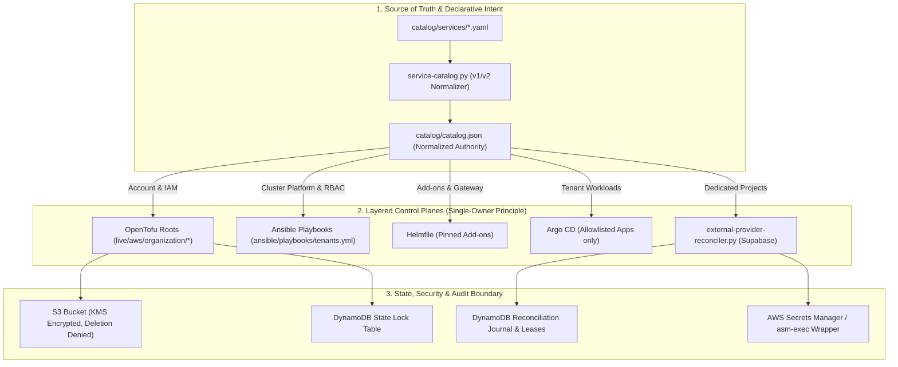

# Production Architecture, Rollout, Rollback & Lifecycle Audit: PR #30

**Pull Request**: [#30 - Add AWS account and Kubernetes service vending](https://github.com/TusharSariyaOrg/aws-account-infra/pull/30)
**Evaluated Branch**: `agent/aws-account-kubernetes-vending`
**Classification**: Enterprise Infrastructure & Multi-Tenant Control Plane Audit

---

## 1. Executive Summary & Architectural Overview

PR #30 establishes a unified, catalog-driven infrastructure vending platform across **AWS Organizations**, **Kubernetes (Homelab)**, **GitHub Repositories**, and **External Providers (Supabase)**.

The core architectural paradigm is **strict ownership segregation, deterministic validation, and fail-closed execution**:
- **Zero Inferred Execution**: CI/CD workflows only execute static validation, linting, and policy enforcement. All mutating operations require explicit, approval-gated triggers (`workflow_dispatch` with GitHub Environment protection or local operator execution).
- **Immutable Bindings**: Service UIDs, AWS Account IDs, Repository Names, Supabase Project Refs, and State Backend keys are immutable once provisioned.
- **Fail-Closed Rollout Gates**: All destructive, external, add-on, and compute-vending features default to `false` in `catalog/external-provider-gates.json` and Ansible group vars.



---

## 2. Layered Control Planes & Ownership Matrix

To prevent dual-authority drift and split-brain states, resource classes are strictly partitioned:

| Domain | Authoritative Tool | Managed Resources | State / Storage Backend |
|---|---|---|---|
| **AWS Organization & Accounts** | OpenTofu | AWS OUs, Accounts, Service Control Policies, IAM Identity Center Permission Sets, Organization Trail | S3: `organization/accounts/<service>/<env>.tfstate` (Management Account) |
| **Account Bootstrap** | OpenTofu | Per-account state bucket, DynamoDB lock table, GitHub OIDC trust, Budget alarms, Service IAM policies | S3: `organization/bootstrap/<service>/<env>.tfstate` |
| **GitHub Repositories** | OpenTofu + `repository-tofu.py` | GitHub Repositories, Branch Protections, Rulesets, Environment secrets / variables | S3: `organization/repositories.tfstate` |
| **Cluster Platform & Tenancy** | Ansible | Namespaces, ResourceQuotas, LimitRanges, NetworkPolicies, HTTPRoutes, RBAC RoleBindings, Native Secrets | `kube-system/tenant-catalog-state` ConfigMap |
| **Platform Add-ons** | Helmfile | Cilium CNI, Gateway API, Prometheus, Kyverno, Argo CD | In-cluster Helm release secrets |
| **Tenant Workloads** | Argo CD | `Deployment`, `StatefulSet`, `ConfigMap`, `ServiceAccount`, `Service`, `Job`, `CronJob`, `HPA`, `ScaledObject` | Git-backed application manifests |
| **External Providers** | Python + OpenTofu | Supabase projects, Auth configs, Redirect URLs, DB instances | S3: `external/supabase/<service>.tfstate` + DynamoDB Journal |

---

## 3. Trust Model & Security Guardrails

1. **GitHub App Secret Isolation (`scripts/repository-tofu.py`)**:
   - The GitHub App private key is fetched via `asm-exec` into memory only.
   - The wrapper mints a 1-hour installation token, immediately unsets the private key from the environment, and invokes OpenTofu. The private key is never passed to OpenTofu or child processes.
2. **CloudTrail S3 Data Events (`live/aws/organization/security`)**:
   - Organization-wide CloudTrail management events are supplemented by explicit S3 Object Data Event auditing on the external state bucket to detect unauthorized access to sensitive OpenTofu state.
3. **Reconciliation Concurrency & Journaling (`scripts/external-provider-reconciler.py`)**:
   - DynamoDB-backed distributed leases serialize external mutations per service.
   - All actions record: `binding_id`, `stage`, `catalog_commit_sha`, timestamps, operator identity, and sanitized results. Secret values are never recorded in logs or DynamoDB.
4. **Kubernetes Secret Materialization**:
   - Secret payloads are injected via stdin (`kubectl apply -f -`), preventing plain-text values from surfacing in shell process tables (`ps aux`), temporary files, or Ansible logs.

---

## 4. Production Rollout Runbook (Phases 1 - 5)

### Phase 1: Management Account & Infrastructure Baseline
1. **Initialize State Backend**: Ensure the management-account S3 state bucket and DynamoDB lock table are provisioned and KMS-encrypted.
2. **Apply Organization Root**:
   ```bash
   tofu -chdir=live/aws/organization/organization init
   tofu -chdir=live/aws/organization/organization apply
   ```
3. **Configure CI/CD Environment Roles**:
   - Set `ACCOUNT_VENDING_PLAN_ROLE_ARN` in GitHub environment `platform-plan`.
   - Set `ACCOUNT_VENDING_APPLY_ROLE_ARN` in approval-gated GitHub environment `platform-prod`.
   - Populate non-secret variables: `CONTROL_PLANE_STATE_BUCKET`, `CONTROL_PLANE_LOCK_TABLE`, `AWS_REGION`, and `MANAGEMENT_GITHUB_OIDC_PROVIDER_ARN`.

### Phase 2: Core Platform Services & Security Delegation
1. **Apply SharedServices Account**:
   - Run GitHub Workflow `account-vend` (`service_id: platform`, `environment: shared-services`, `action: apply`).
   - Merge the automated PR recording the AWS Account ID into `catalog/catalog.json`.
2. **Apply Security Infrastructure**:
   ```bash
   tofu -chdir=live/aws/organization/security apply
   ```
3. **Apply External Control Backend**:
   ```bash
   tofu -chdir=live/aws/organization/external-control apply
   ```

### Phase 3: Workload Account Vending (e.g. CourtBooker)
1. **Plan & Apply Workload Accounts**:
   - Trigger `account-vend` for `court-booker / dev` -> Review & Approve.
   - Trigger `account-vend` for `court-booker / prod` -> Review & Approve.
2. **Bootstrap Repositories**:
   ```bash
   asm-exec -- env 'GITHUB_APP_PEM={{resolve:secretsmanager:...}}' \
     python3 scripts/repository-tofu.py -- tofu -chdir=live/aws/organization/repositories apply
   ```

### Phase 4: Kubernetes Control Plane & Tenant Provisioning
1. **Node Maintenance & Rebuild to v1.35.7**:
   - Capture off-node etcd snapshot and backup `/var/lib/etcd`.
   - Rebuild control plane using Ansible pinned role `v1.35.7`.
2. **Reconcile Platform Add-ons & Tenant Baseline**:
   ```bash
   ANSIBLE_CONFIG=ansible/ansible.cfg ansible-playbook \
     -i ansible/inventories/local/hosts.yml ansible/playbooks/tenants.yml
   ```

### Phase 5: External Service Vending (Supabase)
1. Set gate `platform_supabase_live_enabled: true` in `catalog/external-provider-gates.json` with commit evidence.
2. Reconcile provider under `asm-exec`:
   ```bash
   asm-exec -- env 'SUPABASE_ACCESS_TOKEN={{resolve:secretsmanager:...}}' \
     python3 scripts/external-provider-reconciler.py court-booker \
       --adapter tofu --journal dynamodb \
       --journal-table external-provider-reconciliation \
       --backend-config /secure/path/court-booker-backend.hcl
   ```

---

## 5. Rollback Procedures & Disaster Recovery

### Scenario A: AWS Account Vending Failure / Timeout
- **Symptom**: Network timeout during `aws_organizations_account` creation.
- **Recovery Procedure**:
  1. Do NOT trigger a blind retry.
  2. Inspect AWS Organizations console / CLI: `aws organizations list-create-account-status --states IN_PROGRESS`.
  3. If account was provisioned in AWS:
     ```bash
     tofu -chdir=live/aws/organization/accounts import \
       -var "service_id=<id>" -var "environment=<env>" -var "parent_ou_id=<ou>" \
       aws_organizations_account.this <ACCOUNT_ID>_ALLOW
     ```
  4. Record `<ACCOUNT_ID>` into `catalog/catalog.json` and resume bootstrap.

### Scenario B: Kubernetes Version Rollback
- **Principle**: In-place `kubeadm` downgrades are prohibited by Kubernetes skew policy.
- **Rollback Procedure**:
  1. Cordon and drain the node.
  2. Reinstall base OS packages for target version.
  3. Restore etcd from the pre-maintenance snapshot:
     ```bash
     etcdctl snapshot restore /backup/etcd-snapshot-pre-maintenance.db \
       --data-dir=/var/lib/etcd-restored
     ```
  4. Apply Ansible playbooks with `kubernetes_tenants_argocd_ready: false` until cluster health checks (`/readyz`, Cilium, CoreDNS) pass.

### Scenario C: External Provider Deletion / Purge
- **Principle**: Purge is non-cascading and irreversible.
- **Safety Gate**: Reconciler rejects purge requests unless given a cryptographic confirmation string matching `<SERVICE_UID>:<CATALOG_COMMIT_SHA>`.
- **Retention**: Tombstones in `catalog/catalog.json` remain indefinitely; project UIDs are never recycled.

### Scenario D: CourtBooker Cutover Rollback
- **Procedure**:
  1. Disable EventBridge scheduler rule (`booking_enabled=false`).
  2. Verify no active executions in DynamoDB idempotency table.
  3. Re-enable legacy scheduler stack.
  4. Maintain legacy stack for 7-day observation window before decommissioning.

---

## 6. Day-2 Operations, Patching & Lifecycle Management

1. **Terraform Module Distribution**:
   - Reusable modules are published to the immutable S3 module registry using `scripts/publish-module.sh` (`If-None-Match: *` ensures versions cannot be overwritten).
   - Consumers must verify SHA-256 integrity via `scripts/verify-module.sh` prior to `tofu init`.
2. **Credential & Secret Rotation**:
   - Secrets Manager rotation triggers pod restarts via annotations where `restart_on_rotation: true` is declared in the catalog.
   - Harvester and runtime tokens are rotated independently without modifying tenant repository definitions.
3. **Tenant Lifecycle Transitions**:
   - `active` -> `suspended`: HTTPRoutes detached, Argo CD applications paused, CronJobs suspended, controller scaled to 0, persistent storage preserved.
   - `suspended` -> `archived`: Read-only lock, capacity released from cluster allocation pool.
   - `archived` -> `purge_requested` -> `purged`: Explicit teardown with tombstone preservation.

---

## 7. Audit Conclusion & Readiness Assessment

- **Static Integrity**: 100% Passed (61 Catalog unit tests, 38 Lambda tests, 32 Bats tests, 991 Checkov checks passed, 0 Trivy findings, clean Gitleaks scan).
- **Safety Architecture**: Meets enterprise multi-tenant standards with isolated trust boundaries and fail-closed defaults.
- **Merge Recommendation**: **Ready to merge into `main`**. All live mutations remain deferred until manual operational execution according to the Phase runbooks above.
