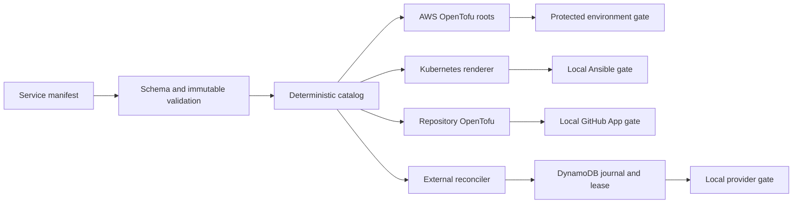

# Implementation Plan: Safe Service Vending

**Branch**: `agent/aws-account-kubernetes-vending` | **Date**: 2026-08-16 | **Spec**: [`spec.md`](spec.md)

## Summary

Retain PR #30's existing catalog-driven implementation and add a truthful Spec Kit
intent/evidence layer. Separate API contracts from product specifications, propagate the
pinned scaffold to the golden repository, adopt one primary local index plus reviewed
Graphify snapshots, and make CI reject traceability drift. No live resource mutation is
part of this plan.

## Technical Context

**Languages and tools**: Python 3.13, Bash, OpenTofu, HCL, Ansible/YAML, Kubernetes 1.35, Spec Kit 0.16.4, RepoWise 0.43.0, Graphify 0.9.45, terraform-docs 0.24.0
**Storage and state**: Git catalog; independent S3/DynamoDB OpenTofu states; DynamoDB reconciliation journal; ignored SQLite/JSON local indexes
**Testing**: pytest/unittest, deterministic render diffs, Ansible syntax, `tofu validate`, TFLint, Checkov, Trivy, Spectral, Gitleaks, Spec Kit audit
**Constraints**: no credentials, live mutations, identity reuse, inferred rollout success, or edits to unrelated desktop/Tailscale work

## Constitution Check

- [x] Declarative ownership and authority boundaries are explicit in the table below and ADR 0001.
- [x] Secret values cannot enter source, logs, diffs, arguments, or agent context; only runtime references are documented.
- [x] Immutable identities and forward lifecycle transitions are defined in `data-model.md` and catalog tests.
- [x] Live, billable, and destructive rollout gates default closed in catalog gates and workflow boundaries.
- [x] Recovery, checkpoints, idempotency, and test evidence are planned in this file, `quickstart.md`, and `tasks.md`.

Post-design check: pass. The local tooling and documentation additions do not acquire new
live authority. Generated repository intelligence remains advisory.

## Architecture and Authority Boundaries

| Domain | Authority | State owner | Mutation boundary | Recovery path |
| --- | --- | --- | --- | --- |
| Catalog | Reviewed Git manifests and JSON Schema | Git history | Maintainer PR | Previous-ref validation and immutable tombstones |
| AWS organization/account | OpenTofu roots | Management-account backend, separate keys | Protected GitHub environments | Exact state import and root-specific recovery |
| AWS workload | OpenTofu | Account/workload backend keys | Protected apply workflow | Roll back through original state only |
| GitHub repository | OpenTofu GitHub provider | Repository root state | Local GitHub App wrapper | Import exact identity, re-plan, preserve history |
| Kubernetes node/platform/tenant | Ansible and Helmfile | Git plus cluster state | Local serialized playbook | Rebuild, verified etcd/app restore, reconcile |
| Tenant GitOps objects | Argo CD allowlist | Tenant repository | Disabled until gates pass | Disable sync; native controls remain |
| Supabase project | OpenTofu provider | Per-service sensitive backend | Local serialized reconciler | Journal checkpoint, exact ref restore, tombstone |
| Secret materialization | Secrets Manager plus `asm-exec` | Secrets Manager | Authorized local runtime | Rotate source secret and rerun idempotently |
| Specifications/contracts | Git | Git history | Maintainer PR | Revert or amend reviewed artifacts |
| Repository intelligence | RepoWise/Graphify local tools | Ignored local directories | Developer machine | Rebuild from pinned version and commit |

## Component Flow



## AWS Architecture

Organization, accounts, access, bootstrap, security, repositories, external control, and
template bootstrap remain separate roots. Plan and apply identities are split. Apply
cannot rewrite bootstrap trust, account closure is excluded, state buckets deny deletion,
and security logging includes external-state object data events once configured.

## Kubernetes Architecture

Ansible owns namespaces and safety controls; Helmfile owns pinned add-ons; Argo CD owns
only namespaced allowlisted application kinds. Native Pod Security and
ValidatingAdmissionPolicy remain authoritative when optional add-ons are off. Moving from
1.36 to 1.35 is a maintenance-window rebuild with verified off-node backups.

## Repository Architecture

The catalog selects a protected golden template. Repository creation is local through a
GitHub App token minting wrapper; CI receives no PEM. Root and template both use Codex
Spec Kit skills, shell scripts, concrete constitutions, and local overrides. Root `specs/`
is intent authority; OpenAPI source moves to `contracts/openapi/`.

## Supabase Architecture

One dedicated project per service is represented by an isolated OpenTofu state key. A
local reconciler obtains a bounded journal lease, resumes named checkpoints, sanitizes
errors, and records provider identifiers without credentials. Purge requires UID plus
catalog SHA. Free-plan pause and lack of included backups remain explicit limitations.

## Secret Handling

Documentation uses only versionless Secrets Manager dynamic references. `asm-exec`
resolves values in the child environment at runtime. The GitHub App wrapper removes its
PEM before minting and executing OpenTofu. Kubernetes Secrets are streamed to `kubectl`
stdin. Sensitive Supabase state is isolated and excluded from ordinary read-only access.

## Identity, Lifecycle, and Rollout Gates

Immutable keys are catalog UID, service ID, repository identity, account key/ID/name/root
email, Kubernetes ECR/hostname identity after activation, Supabase organization/name/
region/project ref, binding ID, and state key. AWS uses active-to-retired, Kubernetes uses
active-to-suspended-to-archived with explicit recovery override, and Supabase adds
purge_requested-to-purged. All live gates remain false until named evidence exists.

## Project Structure

```text
.specify/                         pinned core, constitution, local overrides
.agents/skills/speckit-*/        Codex integration
contracts/openapi/               HTTP API authority
specs/001-safe-service-vending/  intent, plan, evidence and audit artifacts
catalog/                         desired service and cluster state
live/ and modules/               independently recoverable OpenTofu roots/modules
scripts/                         deterministic renderers and bounded reconcilers
templates/service-stack/         golden Spec Kit-ready repository
docs/adr/ and docs/reviews/      stable decisions and reviewed graph evidence
tests/catalog/                   safety and repository-contract evidence
```

## Verification and Recovery

Static verification runs without AWS, Kubernetes, GitHub App, Supabase, or secret
credentials. Recovery drills that create or mutate resources are deferred to protected
operator windows and must attach evidence before a gate changes. Repeated operations use
the same immutable identity and state key; they never create a replacement merely to make
a retry pass.

## Complexity Tracking

| Exception | Why needed | Simpler alternative rejected because |
| --- | --- | --- |
| Multiple OpenTofu roots | Independent authority, blast radius, and recovery | One state would couple management, account, workload, and provider recovery |
| Local serialized provider reconciler | Provider credentials and irreversible lifecycle need a narrow boundary | PR CI would broaden credential and concurrency exposure |
| Two repository tools | RepoWise serves daily context; Graphify provides reviewed point-in-time communities | Either a second always-on index or no independent snapshot loses the stated audit property |
